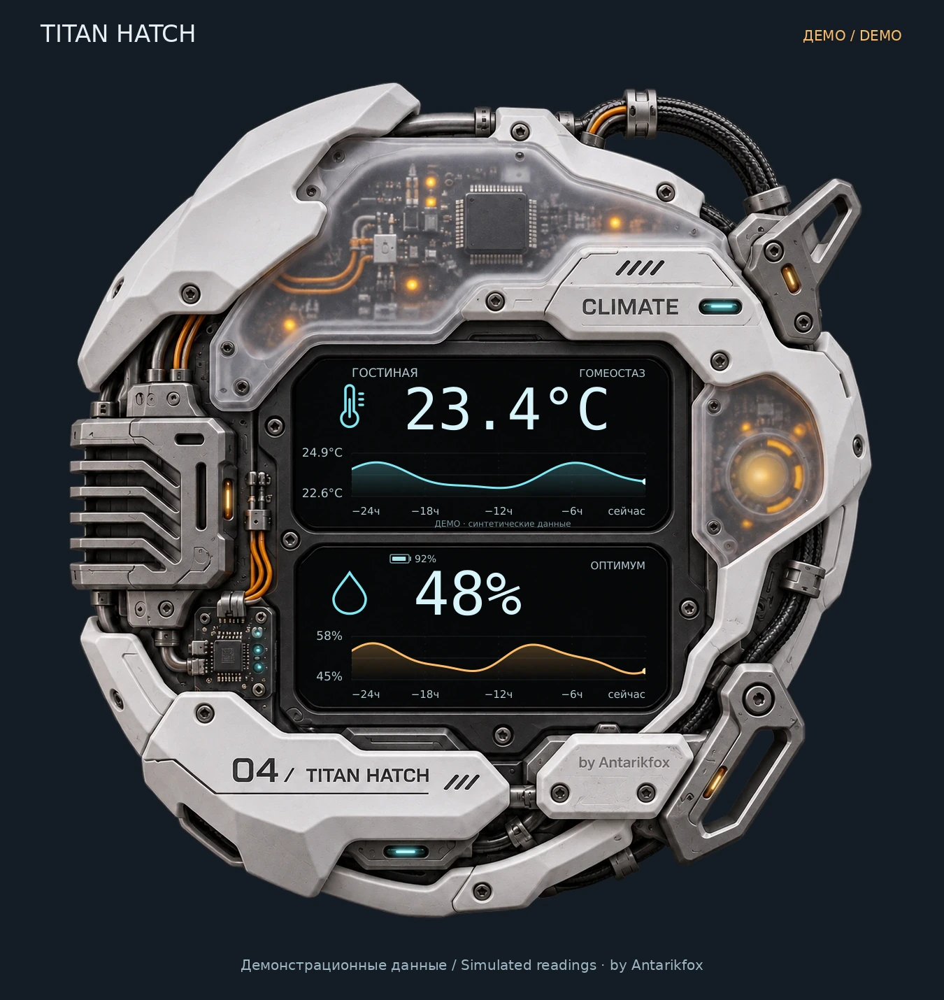

# TITAN HATCH · Climate Card

Климатическая карточка для Home Assistant: температура, влажность и плавные графики за сутки в матовом MECHA-корпусе с живой подсветкой.

A MECHA climate card for Home Assistant: temperature, humidity and smooth 24-hour history graphs, with a matte housing and softly animated LEDs.

**by Antarikfox** · [Русский](#русский) | [English](#english) · [Полная инструкция](START-TITAN.txt) · [Interactive demo](index.html) · [Download standalone demo](TITAN-Climate-Demo.html)



*Превью с демонстрационными данными: 23,4 °C, влажность 48%, история за сутки. В Home Assistant карточка показывает данные твоих датчиков.*

*Preview with simulated readings: 23.4 °C, 48% humidity and 24-hour history. In Home Assistant, the card displays your own sensor data.*

## Русский

## Возможности

- Температура и влажность из Home Assistant, единицы °C / °F.
- Два плавных графика за 24 часа с переходами без ложных пиков.
- Матовая белая броня, полупрозрачные панели, кабели и открытые платы.
- Редкое несинхронное подмигивание LED и слабая пульсация янтарного узла.
- Прозрачный фон; отдельные настройки непрозрачности подложки и корпуса.
- Визуальный редактор сущностей, прозрачности, LED и порогов комфорта.
- Опциональный заряд батареи, статусы и время обновления.
- Обработка пропавшего сигнала и отсутствующей истории.
- Действия по нажатию, удержанию и двойному нажатию.
- Остановка анимаций вне экрана и поддержка уменьшения движения.

Вся графика встроена в `titan-climate-card.js`. Отдельные картинки при установке не нужны.

## Установка через HACS

TITAN HATCH Climate Card включена в основной каталог HACS.

1. Открой HACS в Home Assistant и найди **TITAN HATCH Climate Card** (можно искать `TITAN`).
2. Открой карточку репозитория и нажми **Скачать / Download**.
3. После установки перезагрузи страницу Home Assistant.
4. Добавь карточку через редактор панели или YAML: `type: custom:titan-climate-card`.
5. Выбери свои датчики температуры и влажности.

Если ресурс не появился автоматически, открой **Настройки → Панели управления → ⋮ → Ресурсы** и добавь ресурс типа **Модуль JavaScript**:

```text
/hacsfiles/titan-climate-card/titan-climate-card.js
```

Если пункт «Ресурсы» скрыт, включи расширенный режим в профиле Home Assistant.
Не добавляй один и тот же файл одновременно через `/local/` и `/hacsfiles/`.

### Запасной способ: пользовательский репозиторий

Если поиск HACS пока не показывает карточку, открой **⋮ → Пользовательские репозитории / Custom repositories**, добавь `https://github.com/Antarikfox/titan-climate-card` с типом **Панель / Dashboard**, затем скачай карточку.

## Ручная установка

1. Скачай [`titan-climate-card.js`](titan-climate-card.js) в `/config/www/` Home Assistant.
2. Добавь ресурс типа **Модуль JavaScript**:

   ```text
   /local/titan-climate-card.js?v=1.0.0
   ```

3. Обнови страницу с очисткой кеша.

Для планшета есть [`titan-climate-card.js.txt`](titan-climate-card.js.txt). После скачивания убери только окончание `.txt`.

## Обновление

При установке через HACS скачай доступное обновление в HACS и перезагрузи страницу Home Assistant.
При ручной установке замени JS-файл и измени параметр `?v=` в URL ресурса, затем очисти кеш.
Если карточка уже установлена вручную и ты переходишь на HACS, убери старый ресурс `/local/titan-climate-card.js`, чтобы файл загружался только один раз.

## Карточка

```yaml
type: custom:titan-climate-card
name: Гостиная
temperature_entity: sensor.living_room_temperature
humidity_entity: sensor.living_room_humidity
precision: 1
show_sparkline: true
show_last_updated: true
animations: full
leds_enabled: true
led_brightness: 0.7
background_opacity: 0
background_blur: 0
body_opacity: 1
```

Замени сущности на свои. [Пример для датчиков гостиной Antarikfox](examples/living-room.yaml).

## Прозрачность и свет

| Настройка | Значения | Значение по умолчанию |
| --- | --- | --- |
| `background_opacity` | 0 — прозрачный фон, 1 — тёмная непрозрачная подложка | `0` |
| `body_opacity` | 0 — корпус скрыт, 1 — обычный корпус; показания сохраняются | `1` |
| `background_blur` | Размытие подложки, 0–30 px | `0` |
| `led_brightness` | Яркость живых LED, 0–1 | `0.7` |
| `leds_enabled` | Живые световые эффекты | `true` |
| `animations` | `full`, `reduced`, `off` | `full` |

В режиме `full` LED подмигивают с различными периодами примерно 10–19 секунд. `reduced` сохраняет спокойный свет и плавные графики. `off` отключает анимации. Рисованные блики корпуса остаются частью изображения.

Эти настройки доступны и в визуальном редакторе. Форма карточки квадратная; рекомендуемая ширина от 390 px.

## Данные и история

История читается из Recorder за последние сутки через API Home Assistant. Запросы кешируются на пять минут; текущие показания обновляются по объекту `hass`. Неизвестные и недоступные значения образуют разрывы истории.

Для графиков применяется монотонная кубическая интерполяция с переходом между данными за 1,4 секунды. Если Recorder недоступен или истории нет, карточка продолжает показывать текущие значения.

Опциональный заряд батареи:

```yaml
battery_entity: sensor.living_room_battery
```

Пороги статусов и действия описаны в [полной инструкции](START-TITAN.txt).

## Демо

Скачай и открой `TITAN-Climate-Demo.html` — файл работает локально без интернета. Демо использует **искусственные показания и историю**, а не подключение к твоему HA.

Для GitHub Pages используй ветку `main`, папку `/ (root)`. В корне уже есть `index.html` и `.nojekyll`.

## Разработка и проверка

Node.js нужен только для тестов. Python 3 — только для сборки. Зависимостей для сборки нет.

```sh
npm test
python3 build.py
```

Исходники находятся в `src/`, отдельная исходная графика — в `assets/`. Сборка создаёт автономные JS и HTML в корне репозитория.

`tests/browser-fixture.html` содержит интеграционные проверки с имитацией `hass`; для запуска скопируй рядом с ним собранный JS или размести оба файла в одной папке на локальном сервере.

Проверены пороги, обработка недоступных значений, интерполяция, разрывы истории, конфигурация, прозрачность, светодиоды и редактор. Браузерные проверки выполнялись с имитацией Home Assistant. Проверка на конкретном планшете и реальном HA выполняется после установки.

## License

MIT for the code. Artwork generated for this project. **by Antarikfox**.

## English

[Full English guide](https://github.com/Antarikfox/titan-climate-card/blob/main/START-TITAN-EN.txt) · [English README](https://github.com/Antarikfox/titan-climate-card/blob/main/README.en.md)

### Features

- Home Assistant temperature and humidity readings, with °C / °F support.
- Two smooth 24-hour history graphs with transitions that avoid artificial peaks.
- Matte white armor, translucent panels, cables and exposed circuit boards.
- Occasional asynchronous LED blinking and a subtle amber core pulse.
- Transparent background with separate background and body opacity controls.
- Visual editor for entities, opacity, LEDs and comfort thresholds.
- Optional battery indicator, status labels and last-update time.
- Unavailable sensor and missing-history handling.
- Tap, hold and double-tap actions.
- Animations pause off-screen; reduced-motion preferences are respected.

All artwork is embedded in `titan-climate-card.js`. No separate images are required for installation.

### Install with HACS

TITAN HATCH Climate Card is included in the default HACS catalog.

1. Open HACS in Home Assistant and search for **TITAN HATCH Climate Card** (or `TITAN`).
2. Open the repository entry and select **Download**.
3. Reload the Home Assistant page after installation.
4. Add the card using the dashboard editor or YAML: `type: custom:titan-climate-card`.
5. Select your temperature and humidity sensors.

If the resource was not registered automatically, open **Settings → Dashboards → ⋮ → Resources** and add a **JavaScript module** resource:

```text
/hacsfiles/titan-climate-card/titan-climate-card.js
```

If Resources is hidden, enable Advanced mode in your Home Assistant profile.
Do not load the same card through both `/local/` and `/hacsfiles/`.

#### Fallback: custom repository

If the card does not appear in HACS search yet, open **⋮ → Custom repositories**, add `https://github.com/Antarikfox/titan-climate-card` with type **Dashboard**, then download the card.

### Manual installation

1. Download [`titan-climate-card.js`](titan-climate-card.js) into Home Assistant's `/config/www/` directory. Create `www` if needed.
2. Add a **JavaScript module** resource:

   ```text
   /local/titan-climate-card.js?v=1.0.0
   ```

3. Reload the page and clear the browser cache.

For devices that have trouble downloading JS files, use [`titan-climate-card.js.txt`](titan-climate-card.js.txt) and remove only the final `.txt` extension.

### Updates

For a HACS installation, download the available update in HACS and reload Home Assistant.
For a manual installation, replace the JS file, change the `?v=` value in the resource URL and clear the browser cache.
When switching from a manual installation to HACS, remove the old `/local/titan-climate-card.js` resource so that the card loads only once. You can keep the card's YAML configuration.

### Card configuration

```yaml
type: custom:titan-climate-card
name: Living room
temperature_entity: sensor.living_room_temperature
humidity_entity: sensor.living_room_humidity
precision: 1
show_sparkline: true
show_last_updated: true
animations: full
leds_enabled: true
led_brightness: 0.7
background_opacity: 0
background_blur: 0
body_opacity: 1
```

Replace the entity IDs with your own. [Antarikfox living-room example](examples/living-room.yaml).

### Opacity and lighting

| Setting | Values | Default |
| --- | --- | --- |
| `background_opacity` | 0: transparent background; 1: opaque dark background | `0` |
| `body_opacity` | 0: hidden body; 1: normal body; readings remain visible | `1` |
| `background_blur` | Background blur, 0–30 px | `0` |
| `led_brightness` | Animated LED brightness, 0–1 | `0.7` |
| `leds_enabled` | Live lighting effects | `true` |
| `animations` | `full`, `reduced`, `off` | `full` |

In `full` mode, LEDs blink at different intervals of approximately 10–19 seconds.
`reduced` keeps steady lighting and smooth graph transitions. `off` disables animations.
Painted highlights remain part of the body artwork.

These settings are also available in the visual editor. The card is square; a width of at least 390 px is recommended.

### Data and history

The card requests the last 24 hours of Recorder history through the Home Assistant API.
History requests are cached for five minutes; current readings update through the `hass` object.
Unknown and unavailable values create gaps in the history.

Graphs use monotone cubic interpolation and 1.4-second transitions between updates.
If Recorder or history is unavailable, the card continues to display current readings.

Optional battery sensor:

```yaml
battery_entity: sensor.living_room_battery
```

See the [full guide](START-TITAN-EN.txt) for comfort thresholds and actions.

### Demo

Download and open `TITAN-Climate-Demo.html`. It works offline and uses **simulated readings and history**, with no connection to your Home Assistant.

For GitHub Pages, select branch `main` and folder `/ (root)`. The repository already includes `index.html` and `.nojekyll`.

### Development and validation

Node.js is required only for tests. Python 3 is required only for building. The build has no external dependencies.

```sh
npm test
python3 build.py
```

Source files are in `src/`; original artwork is in `assets/`. The build generates standalone JS and HTML files in the repository root.

`tests/browser-fixture.html` contains integration checks using a simulated `hass` object. Copy the built JS file next to the fixture, or serve both from the same directory on a local server.

Validation covers thresholds, unavailable values, interpolation, history gaps, configuration, opacity, LEDs and the editor. Browser checks use a simulated Home Assistant environment. Check the installed card with your own sensors and device.

### License

MIT for the code. Artwork generated for this project. **by Antarikfox**.

## Корпус / Housing artwork


